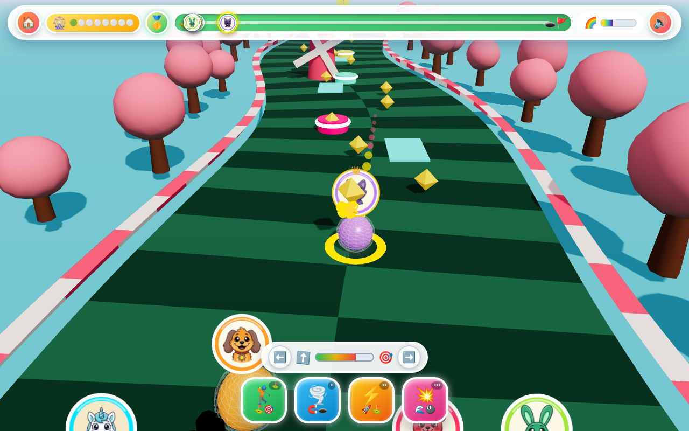

# ⛳ Critter Mini-Golf 3D: Windmill Wonder Course! 🎡✨

**Live Game**: [https://kunruiw1991.github.io/critters-golf3d/](https://kunruiw1991.github.io/critters-golf3d/)

## 🌟 Overview
**Critter Mini-Golf 3D: Windmill Wonder Course!** is a whimsical 3D WebGL Mini-Golf Race & Obstacle Course Party game built with **Three.js** (`r161`) for young children. Pick from **8 Smiling Critters** and putt/race your 3D crystal golf ball simultaneously against 4 rival Critters across **8 vibrant mini-golf courses** filled with rotating 3D windmill blades, bouncy pinball bumper pads, speed boost carpets, arched walnut-wood bridges, and glowing flag-cup holes!

## 🏗️ 3D WebGL Engine Highlights
- **Calibrated Physical Lighting & Soft Shadows**: Uses `HemisphereLight` + `DirectionalLight` with `ACESFilmicToneMapping` and a `2048×2048` `PCFSoftShadowMap` frustum tracking the player ball, paired with ground-locked radial contact-shadow decals (`y = -0.71 - hopY`) that scale and fade smoothly during vertical hops.
- **Continuous Ribbon Course & Arched Walnut Bridges**: The curved S-fairway and candy bumper rails are generated as continuous vertex-colored `BufferGeometry` ribbons sampled at 1-unit resolution along the curve normal with `smoothstep` width transitions and arched wooden bridge decks, keeping draw calls under 55 even on Stage 8.
- **Substepped 3D Contact Physics & Tactile Impact Layer**:
  - **Physics Substeps (`1..6` per frame)**: Prevents high-speed tunneling through windmill blades or bumpers across `20–144 FPS`.
  - **Trauma Camera Shake & FOV Kick**: Separate `camBase` chase state with quadratic trauma shake + roll (`prefers-reduced-motion` aware) and `52° → 58°` FOV boost kicks.
  - **Additive 3D Shockwave Rings & 1-Draw-Call Instanced Particles**: Pool of 6 additive `RingGeometry` shockwaves (`easeOutCubic`) and a 64-instance `THREE.InstancedMesh` particle system supporting directional normal sparks and fountain bursts.
  - **3D Vertical Hops, Squash-and-Stretch & Elastic Billiard Collisions**: Gravity-driven vertical hops (`-32 u/s²`) with landing squash-and-stretch, mass-weighted racer-vs-racer momentum exchange (`Bubba` mass `1.8` vs `1.0`), radial delayed `💥` Bump Wave shockwaves, and 3D quadratic Bézier flying star coins into the `🌈` gauge.
- **256×256 Circular Medallion Portraits & Distance Scaling**: Loads all 8 Critter icons (`icons/*.jpg`) into circular `CanvasTexture` medallions with a golden crown outer rim (`renderOrder = 10`, `2.15u` scale) for the player, dynamic distance-compensated scaling for rival medallions down-course, `alphaTest: 0.1`, and a 2-stage Cup Drop + Parabolic Hop onto a 5-step 3D podium around the cup.
- **8 Distinct Stage Prop Kits & CIE76 `ΔE ≥ 31` Color Contrast**: Every stage features its own sky/horizon gradient, water tint/emissive, lighting palette, styled stage card, and 28 roadside `THREE.InstancedMesh` props (`🌸` blossom trees, `🌈` rainbow arches, `🍭` candy lollipops, `🏰` stone castle turrets, `🌴` coconut palms, `🚀` ringed planets & starfield, `🌋` glowing lava volcanoes, and `👑` golden palace columns & trophies), verified at boot (`minDeltaE = 31.4`).

## 🎮 Controls & 4 Giant Cockpit Pedals (100% Zero-Text Visual Cockpit)
- **🏌️ Quick Putt Pedal (`Up Arrow` / `W` / Green Pedal) & Interactive `⬅️`/`➡️` Aim Pill**: Tap `⬅️`/`➡️` (`≥ 44px` touch targets) or drag anywhere on the 3D course to steer the rotating `⬆️` aim arrow, and tap the green `🏌️` Quick Putt pedal or power bar to launch a turbo putt!
- **🌪️ Hole Magnet Vortex (`Key 1` / `•` Cyan Pedal)**: Activates a magnetic funnel that curves and pulls your golf ball toward the fairway centerline and glowing flag cup.
- **⚡ Rocket Putt (`Key 2` / `Space` / `••` Gold Pedal)**: Launches a golden turbo putt straight down the course.
- **💥 Rival Bump Wave (`Key 3` / `•••` Pink Pedal)**: Releases a cheerful radial shockwave ring that hops and bounces nearby rival golf balls outward as the wave front reaches them.
- **🌈 Rainbow Fever**: Fill the Rainbow meter by sinking stars, hitting bumpers, and launching putts to trigger glowing `.active-fever` super-speed Rainbow Fever (`🌈🔥`)!

## 🏆 Top-3 Podium Qualification & 8 Courses
- **1st Place (`🥇` `✅`)**: `⭐⭐⭐` (Unlocks next course)
- **2nd Place (`🥈` `✅`)**: `⭐⭐☆` (Unlocks next course)
- **3rd Place (`🥉` `✅`)**: `⭐☆☆` (Unlocks next course)
- **4th / 5th Place (`4️⃣`/`5️⃣` `❌`)**: `☆☆☆` (Defeat — Retry course to qualify!)

## 🔄 Iterative Testing & Refinement Changelog
- **Round 1 (3D WebGL Scene Architecture, Lighting/Shadows & Asset Loading)**: Added `PCFSoftShadowMap` shadow pipeline + contact shadow decals, calibrated `HemisphereLight` + `DirectionalLight` with `ACESFilmicToneMapping`, continuous ribbon `BufferGeometry` fairway/rails with `smoothstep` arched bridges, `disposeTree` GPU resource cleanup, and `256×256` circular medallion `CanvasTexture` portraits with fallback resilience.
- **Round 2 (8 Smiling Critters Picker, Upright 3D Medallions & 8 Stage Themes)**: Added live 3D character & stage preview on tap alongside a side-docked responsive menu card (`1280×800`, `1366×768`, `844×390`, `390×844` zero-scroll fit), unique visible & functional Critter perks + `🆚` matchup preview strip, golden-crowned player medallion + distance-scaled rival medallions + `camera.setViewOffset` framing + 5-step 3D cup podium, 8 stage prop kits via `THREE.InstancedMesh`, and segment-accurate 4-blade windmill collision.
- **Round 3 (Core 3D Physics, Tactile Collision Impact & Substepped Stability)**: Added trauma camera shake + FOV boost kicks, 6-ring additive 3D shockwave pool, single-draw-call 64-instance `THREE.InstancedMesh` directional/fountain particles, 3D vertical hop physics (`vy`, `hopY`, landing squash-and-stretch, ground-locked shadow decals), mass-weighted elastic racer-vs-racer momentum collisions, radial wave-front delayed `💥` Bump Wave, 3D Bézier + DOM flying star coins, substepped physics (`1..6` steps/frame), entry-triggered tangent boost pads, 2-stage Cup Drop + Parabolic Podium Hop, and verified CIE76 `ΔE ≥ 31` contrast across all 8 Critters (`hoppy` electric volt `0xd9f938`).
- **Round 4 (100% Zero-Text Visual Cockpit, Touch Steering & Clear Affordances)**: Removed all residual English tooltip attributes and replaced numeric key badges with icon pips (`•`, `••`, `•••`), added a 4th giant `🏌️⛳` Quick Putt pedal and interactive `#aim-hint-pill` with `⬅️`/`➡️` (`≥ 44px`) touch-aim nudge buttons + rotating `⬆️` aim indicator, added live `#hud-rank-badge` (`🥇`–`5️⃣`) with Top-3 qualification rim and overtake pop, implemented `.is-ready`/`.on-cooldown`/`.cooldown-shake` pedal states + `.active-fever` rainbow glow, and added `✅`/`❌` podium qualification badges + `.cta-pulse` primary button highlight.
- **Round 5 (AI Rival Personality, Rubber-Banding, Boost-Pad Seeking & Windmill Avoidance)**: Added per-slot AI pacing (`0.96..0.77`), dynamic rubber-banding + early-stage green hesitation (`Stage 1` `0.12×` brake at `> 76%` progress), boost-pad seeking on Stages 2–8, lateral windmill-tower avoidance (`±3.2u`), lively AI mini-hops near the player, and backward-only (`+Z`) radial `💥` Bump Wave knockback.
- **Round 6 (Procedural Web Audio Synthesis, Dynamic Fever BGM & Spatial Falloff)**: Added explicit zero-click `linearRampToValueAtTime` attack envelopes and `osc.onended` node cleanup in `SoundEngine.tone()`, custom multi-oscillator SFX for `🌪️` Vortex, `⚡` Rocket, and `💥` Bump Wave, dynamic BGM pitch/harmonic shift (`1.25×` + octave shimmer) during `🌈🔥` Rainbow Fever, spatial distance volume scaling (`0.35×`) for AI impacts, and a 4-note descending slide-trombone glissando on 4th/5th defeat.
- **Round 7 (Stage Progression, Star Persistence, 3D Power Trails & Podium Polish)**: Fixed `concludeStageRace()` to finalize all 5 racers into `finishOrder` by descending progress, added immediate 5th-place termination if all 4 AI rivals sink first, added continuous 3D spinning vortex funnel + flame/rainbow particle trails on the player ball, and upgraded the result modal with `.victory-card`/`.defeat-card` styling, `⭐⭐⭐` tier badges, `🚧` Top-3 cutoff divider, and dynamic `⏭️🌈` next-stage CTA icons.
- **Round 8 (Mobile Safe-Area Insets, Touch Ergonomics, Accessibility & WebGL Resilience)**: Added `viewport-fit=cover` with `env(safe-area-inset-*)` padding, clamped mobile HUD gaps to fit `360×640`, enforced `user-select: none` and `:focus-visible` keyboard navigation across all Critter/Stage cards, added `@media (prefers-reduced-motion: reduce)` animation guards, cached `PERSISTENT_GEOMETRIES`/`PERSISTENT_MATERIALS`/`PERSISTENT_TEXTURES` against premature disposal, and added a zero-text `🖥️🎮✨` WebGL fallback banner.
- **Round 9 (End-to-End Gameplay Polish, Anti-Stuck Watchdog & Lifecycle Guardrails)**: Tracked and cleared `gameState.concludeTimerId` across stage starts and menu navigation to prevent stale result modals, added a `racer.stuckTimer` anti-stuck centerline recovery hop for wedged balls, hardened `onWindowResize()` and `pointercancel`/`blur` aim-drag cleanup, and purged in-flight `.flying-star-coin` DOM elements on stage resets.
- **Round 10 (Final Verification, Screenshot Capture & GitHub Pages Deployment)**: Verified zero console errors, all 8 Critter medallions and 8 themed 3D mini-golf stages, substepped physics, Web Audio synthesis, and responsive HUD ergonomics across desktop and mobile viewports; captured `1280×800` gameplay preview screenshot and deployed to GitHub Pages.

